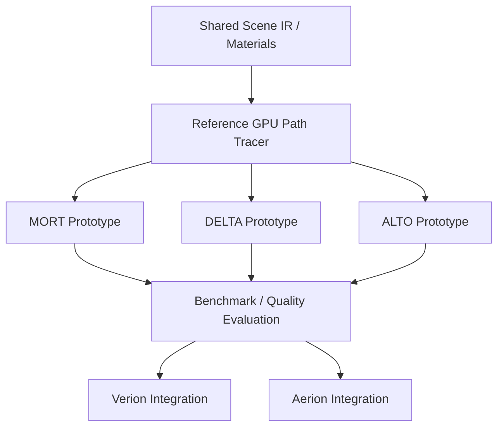

# Experimental Light Transport Research — 研究テーマ3案

> Status: Research proposal / 2026-11-05  
> Targets: **Verion**（高品質GPUパストレーサー）、**Aerion**（リアルタイムHybrid Renderer）  
> Purpose: 光輸送の計算量そのものを減らす、新しいレンダリング手法の探索。

## 0. 研究方針

単なるGPUカーネルの最適化ではなく、**同一画質を得るために必要な光輸送計算を削減する**。本書の名称・アルゴリズム・数式の発展方向は研究仮説であり、新規性・性能・正しさが実証されたものではない。

| テーマ | 中心的な問い | Verionでの利用 | Aerionでの利用 |
|---|---|---|---|
| **MORT** — Multiscale Operator Residual Transport | 近似できない残差だけを効率よく解けるか | 低分散・収束加速 | 階層別の品質制御 |
| **DELTA** — Differential Event-aware Light Transport Acceleration | シーン変更の影響を受ける光路だけ更新できるか | アニメーション連番の加速 | 動的GIの更新量削減 |
| **ALTO** — Adaptive Low-rank Transport Operator | レイ追跡の一部を圧縮演算子の適用へ置き換えられるか | 大域輸送の初期解・補助解 | リアルタイムの光輸送ソルバー |

---

## 1. MORT — Multiscale Operator Residual Transport

### 目的・仮説

光輸送を階層的な安価な近似と、その近似に残る高周波・局所的な残差へ分解する。階層ごとにGPU時間を適応配分すれば、通常のPath Tracingや単一のRadiance Cacheより**同一時間での誤差**を減らせる可能性がある。

### 数学的構成

レンダリング方程式を演算子形式で書く。

$$L=E+\mathcal{K}L.$$

任意の近似放射輝度 $L_0$ に対して $L=L_0+\Delta L$ とおくと、

$$
(I-\mathcal K)\Delta L=E-(I-\mathcal K)L_0,
$$

$$
\Delta L=(I-\mathcal K)^{-1}\bigl[E-(I-\mathcal K)L_0\bigr]
$$

となる（逆演算子が適切に定義できる条件下）。階層 $j$ ごとの近似・補正を用いて、

$$L\approx L_0+\sum_{j=1}^{m}\Delta L_j$$

とする。**重要**：残差が小さいだけではMonte Carlo推定の分散削減は保証されない。近似評価のコストと、補正推定器の分散・相関を同時に分析する。

### 提案アルゴリズム

1. シーンの位置・法線・粗さ・照明分布に応じて、Sparse Gridと方向基底から粗い $L_0$ を構築。
2. 階層ごとに残差の分散と計算コストを推定。
3. 「追加1 GPU-msあたりの期待誤差削減」が大きい階層へサンプルを割り当てる。
4. Verionでは補正推定を継続し、正しい最終結果への収束を検証。Aerionではフレーム予算に応じて階層を打ち切る。
5. 破綻しやすい細部・鏡面・コースティクスは専用の残差サンプリングへ振り分ける。

### 先行研究と差分の候補

- [Real-time Neural Radiance Caching for Path Tracing (2021)](https://research.nvidia.com/index.php/publication/2021-06_real-time-neural-radiance-caching-path-tracing)：オンライン学習するRadiance Cache。
- [Neural Two-Level Monte Carlo Real-Time Rendering (2025)](https://doi.org/10.1111/cgf.70050)：二段階推定、Control Variates・残差の検討。
- [Illumination-Aware Spatial Subdivision for Path Guiding (2026)](https://studios.disneyresearch.com/2026/07/01/illumination-aware-spatial-subdivision-for-path-guiding/)：照明分布に応じた適応的空間分割。

**主張を目指す差分**：空間・方向・周波数の階層構造を、残差分散とGPU実行コストに基づいて共同最適化する点。残差法自体は既知であり、それだけを新規性として主張しない。

### 実験

- **シーン**：Cornell Box、複雑な室内、狭い開口、鏡面、ガラス、強い間接照明。
- **比較**：Path Tracing + MIS、単一階層Cache、階層のみ、残差のみ、固定予算、適応予算。
- **指標**：Time-to-Quality、HDR相対MSE、FLIP、GPU-ms、VRAM、キャッシュ構築と更新の時間。
- **反証条件**：残差補正のGPUコストが分散削減の利益を恒常的に上回る、または複雑な光路で系統誤差が大きい。

### 最小プロトタイプ

Neural Networkなしの小規模な拡散反射シーンから開始。SHまたは方向ビン付きのSparse Gridを $L_0$ とし、MC残差推定を追加。低分散化が観測できてから学習型表現を検討する。

---

## 2. DELTA — Differential Event-aware Light Transport Acceleration

### 目的・仮説

動的シーンの各フレームを最初から描画せず、変更の影響を受けた光路空間の差分を推定する。滑らかな変化と可視性の不連続な変化を別々に扱い、更新コストを変更規模に近づける。

### 数学的構成

画像を $I_t$ とすると、

$$I_t=I_{t-1}+\Delta I_t.$$

両フレームの光路を共通のサンプル空間 $u\in[0,1]^d$ へ写像し、適切なヤコビアンや重みを含む寄与 $F_t(u)$ が定義できるなら、

$$
\Delta I_t=\int_{[0,1]^d}\bigl(F_t(u)-F_{t-1}(u)\bigr)\,du.
$$

さらに変化を概念的に、

$$\Delta I_t=\Delta I_{\mathrm{smooth}}+\Delta I_{\mathrm{visibility}}$$

へ分ける。後者の正確な取り扱いには遮蔽境界に関する積分・サンプリングが必要。前フレームの推定誤差はそのまま蓄積し得るため、定期的な再推定や誤差管理を設計する。

### 提案アルゴリズム

1. Scene IRからライト・形状・材質・カメラの変更イベントを取得。
2. 変更された幾何・遮蔽の影響を受け得る光路の索引をGPU上に構築・更新。
3. 滑らかな変化には相関した光路サンプル、可視性変化には境界指向のサンプリングを用いる。
4. 差分の不確実性を推定して追加サンプルを配分。
5. 変更が大規模・急激な場合はフル再計算へフォールバック。

### 先行研究と差分の候補

- [Residual Path Integrals for Re-rendering (2024)](https://www.iliyan.com/publications/ResidualPathIntegral/)：動的変更に対する光輸送差分の積分・サンプリング。
- [Differentiable Monte Carlo Ray Tracing through Edge Sampling (2018)](https://cseweb.ucsd.edu/~tzli/diffrt/)：可視性境界での微分を扱うサンプリング。
- [Markov-Chain Monte Carlo Sampling of Visibility Boundaries (2024)](https://dspace.mit.edu/entities/publication/a8e36633-f907-45de-acc4-de5cca500fc0)：可視性境界のサンプリング改良。

**主張を目指す差分**：GPU上の変更イベントからの影響光路索引、平滑・境界推定器の動的選択、誤差に基づくフル更新への切替を統合すること。差分レンダリングそのものは既知。

### 実験

- **変更ケース**：小ライトの移動、単一球体の移動、ドア開閉、大量の動的物体、急激なカメラ移動。
- **比較**：フレームごとのPath Tracing、時間的再利用、相関サンプル差分、Residual Path Integralsを再現した方式。
- **指標**：同一画質でのフル再計算との速度比、変化直後の誤差、時間的ちらつき、影響索引の構築時間、誤差蓄積、回復フレーム数。
- **反証条件**：光路影響の探索が実際の再計算より高価、または境界変化を見逃して大きな偏りが生じる。

### 最小プロトタイプ

固定カメラ・固定材質・移動する単一ライトから開始。次に移動球体による遮蔽境界を扱い、最後に多重反射と動的ジオメトリを追加する。

---

## 3. ALTO — Adaptive Low-rank Transport Operator

### 目的・仮説

個々の光路を毎回追跡する代わりに、光輸送演算子を「局所的な疎構造＋大域的な低ランク構造＋特殊光路の残差」として保持する。構築・更新費用を含めても、複数フレームにわたる計算コストを減らせる条件を探索する。

### 数学的構成

離散化したレンダリング方程式：

$$\mathbf L=\mathbf E+\mathbf K\mathbf L.$$

輸送演算子を、

$$\boxed{\mathbf K\approx\mathbf K_{\mathrm{sparse}}+\mathbf U\mathbf V^\top}$$

と近似する。すると、

$$\mathbf K\mathbf L\approx\mathbf K_{\mathrm{sparse}}\mathbf L+\mathbf U(\mathbf V^\top\mathbf L).$$

$\mathbf K\in\mathbb R^{n\times n}$、低ランク項のランク $r\ll n$ の場合、演算子適用の計算量は概ね $O(\operatorname{nnz}(\mathbf K_{\mathrm{sparse}})+nr)$。ただし、**前処理・基底学習・動的更新・収束までの反復回数を含めた実測**が必須。

変更時には、

$$\mathbf K_{t+1}=\mathbf K_t+\Delta\mathbf K$$

として $\Delta\mathbf K$ の低ランク・局所性を検証する。

### 提案アルゴリズム

1. 光路を使って輸送演算子の一部を観測し、局所相互作用と大域的な相関を推定。
2. 拡散反射は低ランク基底、局所遮蔽は疎構造、鏡面・屈折などは残差サンプリングへ振り分ける。
3. 誤差とGPU時間の見積もりに基づき、ブロックごとにランクや分割を適応変更。
4. 動的変更時は影響したブロック・基底のみ再計算できるか検証。
5. Verionでは演算子解を補助推定として補正し、Aerionでは指定時間内の近似解を出力。

### 先行研究と差分の候補

- [A Rapid Hierarchical Radiosity Algorithm (1991)](https://cs468.stanford.edu/papers/rad/)：階層的輸送行列。
- [A Meshless Hierarchical Representation for Light Transport (2008)](https://research.aalto.fi/en/publications/a-meshless-hierarchical-representation-for-light-transport/)：階層的・点ベースの輸送表現。
- [Dynamic Neural Radiosity with Multi-grid Decomposition (2024)](https://woaixuexisr.github.io/papers/dynamic-neural-radiosity/)：動的シーンの分解型Radiance Field。

**主張を目指す差分**：疎＋低ランク＋確率的残差を統合した適応的なGPU光輸送ソルバーと、動的変更時の部分更新。既知の行列圧縮との比較は不可欠。

### 実験

- **初期実験**：小シーンで輸送行列を明示的に作り、特異値の減衰・最適ランク・圧縮誤差を観測。
- **比較**：密行列、疎行列のみ、固定ランク近似、階層的Radiosity、Path Tracing。
- **指標**：構築時間、演算子適用時間、VRAM、相対誤差、反復収束、更新時間、ブレークイーブンフレーム数。
- **反証条件**：一般的な光輸送で必要ランクが高すぎる、可視性の変化で演算子のほぼ全再構築が必要、または構築コストを回収できない。

同一画質で $T_{\mathrm{PT}}>T_{\mathrm{ALTO}}$ なら、前処理費用の損益分岐フレーム数は概ね、

$$N_{\mathrm{break-even}}=\frac{T_{\mathrm{build}}}{T_{\mathrm{PT}}-T_{\mathrm{ALTO}}}.$$

### 最小プロトタイプ

まず完全拡散・静的な小シーンを離散化。SVD・Randomized SVD・ブロック圧縮の性能を比較し、十分な低ランク性が観測できた場合にのみ鏡面や動的シーンへ進める。

---

## 4. 共通実験基盤

### 公平な実験条件

- 同一GPU・解像度・シーン・BSDF・光源条件を使う。
- 独立に十分収束したPath Tracingを参照画像とする。
- GPUカーネルだけでなく前処理・推論・キャッシュ更新・転送の時間も含める。
- 静止画はTime-to-Quality、動画は品質付きフレーム時間と時間的安定性で比較。
- HDR相対誤差と知覚的指標（FLIP等）を併用。平均値だけでなく最悪ケースや失敗シーンを記録。
- バイアス、分散、時間的誤差の蓄積を区別する。
- 各新機構を単独で無効化したアブレーション実験を行う。

## 5. 推奨優先順位と90日計画

**第一候補：MORT**。Verionの収束性能とAerionの時間予算付き描画を同一の理論で扱える可能性があり、比較的小さい実験で反証できる。**第二候補：DELTA**は動的シーンでの価値が明確。**長期的な挑戦：ALTO**は前処理と高ランク現象の難しさが最大の障壁。

| 期間 | 内容 | 判断ゲート |
|---|---|---|
| Day 1–20 | MORTの推定器を導出、小規模CPU数値実験 | バイアス・分散の数学的検証 |
| Day 21–45 | GPU Path Tracer + 階層近似・残差 | ベースラインと同条件で動作 |
| Day 46–65 | GPU-ms対誤差の比較・アブレーション | 追加コストを上回る利益があるか |
| Day 66–90 | 難しいシーン・動的条件・失敗分析 | 研究継続・修正・撤退を判断 |

## 6. 最終的な展望

長期的には、**ALTOで大域的な輸送を表現し、MORTで近似残差を補正し、DELTAで動的変更部分を更新する**統合方式が考えられる。ただし各案を単独検証するまでは統合の速度向上を前提にしない。

**研究の中核的な問い：要求画質を実現するための光輸送計算量を、どこまで減らせるか。**
